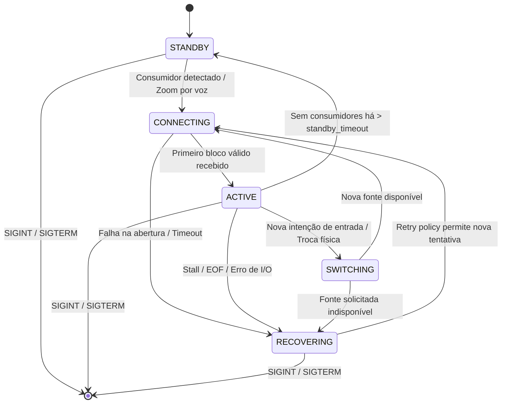

# Documentação de Troca Dinâmica de Microfone e Resiliência de Captura (AUD-SW-06)

## 1. Visão Geral

Esta documentação descreve a arquitetura, estados de ciclo de vida, prazos operacionais, política de reconexão e matriz de testes da correção de troca dinâmica de microfone no **OpenNPUEffects**.

A correção resolve o defeito estrutural de leitura bloqueante indefinida (`in_proc.stdout.read()`) no daemon de áudio (`npu_audio_daemon.py`), introduzindo I/O não bloqueante delimitado por prazos absolutos, barreiras de época para invalidar blocos e parciais antigos, preservação de estados de silêncio e reconexão com backoff exponencial limitado.

---

## 2. Estados do Ciclo de Vida da Captura

O subsistema de áudio opera segundo os seguintes estados explícitos (`AudioCaptureState`):



### Detalhamento dos Estados e Garantias de I/O:
- **`STANDBY`**: Nenhum aplicativo consome o microfone virtual `npu_clearvoice`. O processo físico `pw-record` é encerrado para apagar o LED do microfone físico. O daemon mantém emissão ritmada de blocos de silêncio (PCM float32 zeros a cada 128 ms) para o sink virtual, preservando a conexão com OBS/WebRTC.
- **`CONNECTING`**: O daemon inicializou o processo `pw-record --raw` (`bufsize=0`) com uma nova identidade de geração (`audio_gen_id`) e aguarda a chegada do primeiro bloco completo. Enquanto o bloco está pendente (`PENDING`), o daemon continua emitindo silêncio ritmado no sink virtual e verificando sinais/configuração sem bloquear.
- **`ACTIVE`**: Captura e processamento normais em execução. Blocos de 2.048 amostras (128 ms, 8.192 bytes) são submetidos à supressão de ruído na NPU e aos efeitos de estúdio DSP. Se um bloco completar após um bloco de silêncio já ter sido emitido para cobrir a janela (`first_byte_time < last_silence_time`), o bloco atrasado é descartado como obsoleto (`audio_stale_block_rejected_total`) para impedir desalinhamento de fase/atraso acumulado.
- **`SWITCHING`**: Uma alteração na fonte solicitada (`input_device`) ou na melhor fonte física detectada (`best_mic`) foi observada. A época (`epoch`) é incrementada imediatamente, o leitor ativo descarta quaisquer bytes parciais acumulados e o processo anterior é encerrado de forma controlada (`stop_process` aplica `O_NONBLOCK` nos descritores e encerra o processo antes de fechar streams).
- **`RECOVERING`**: Ocorreu um stall (tempo limite de formação excedido), encerramento prematuro (`EOF`), erro de pipe ou a fonte física solicitada não está disponível (`SOURCE_UNAVAILABLE`). O daemon emite silêncio e aguarda a janela de retry com backoff.
- **`STOPPING`**: Encerramento ordenado ao receber `SIGINT` ou `SIGTERM` (`coordinator.mark_stopping()`), com liberação e recolhimento de subprocessos dentro de prazos estritos.
- **Escrita de Saída Incremental Não Bloqueante (`AudioOutputWriter.write_step`)**: Configura o descritor de saída com `os.set_blocking(fd, False)` e avança incrementalmente passo a passo no loop de controle (`write_step`) com janela de poll de `25 ms` por passo e deadline total de `500 ms` por bloco, mantendo no máximo 1 bloco pendente em voo. Escritas parciais nunca são contabilizadas como blocos completos (`samples_written = 0`) até que os `8.192` bytes sejam integralmente entregues; tentativas de iniciar um novo bloco enquanto outro ainda está pendente são rejeitadas (`pending_write_already_in_progress`) sem corromper o bloco em voo; em troca de microfone, qualquer bloco de saída pendente é cancelado explicitamente (`cancel_pending(reason="source_switch")`) e, se já houve entrega parcial (`requires_reconnect=True`), o `out_proc` é reiniciado para preservar o alinhamento de `float32`. O resultado separa `bytes_written` (bytes efetivamente entregues), `partial_discarded_bytes` (bytes restantes descartados) e `original_block_bytes` (tamanho total do bloco). A reconexão do sink virtual (`out_proc`) é governada por `CaptureRetryPolicy` independente (`sink_retry_policy`), registrando falha apenas em erros reais de escrita/spawn (sem renovar o timer de backoff durante esperas quando `out_proc is None`).

---

## 3. Prazos e Constantes de Engenharia

| Parâmetro | Valor | Descrição |
|---|---|---|
| Taxa de amostragem | 16.000 Hz | Taxa padrão do modelo de supressão de ruído PoCoNet |
| Tamanho do bloco | 2.048 amostras | 128 ms por bloco (8.192 bytes float32 mono) |
| Timeout de poll de I/O | 25 ms | Máxima espera por leitura/select antes de retornar ao loop de controle |
| Intervalo de checagem de config | 200 ms | Cadência de polling do arquivo `~/.config/npu-effects/config.json` |
| Deadline de formação de bloco | 750 ms | Prazo máximo absoluto para montar 8.192 bytes durante captura ativa |
| Tolerância inicial na abertura | 1.500 ms | Prazo estendido para a chegada do primeiro bloco após inicialização do PipeWire |
| Deadline de escrita de saída | 500 ms | Prazo de timeout ao escrever no pipe `pw-play` |
| Encerramento de subprocessos | 400 ms | Tempo de espera com `SIGTERM` antes de escalonar para `SIGKILL` |
| Timeout de comandos externos | 500 ms | Prazo em `subprocess.run` para comandos como `pactl`, `pw-link` |

---

## 4. Política de Retry e Backoff

A classe [`CaptureRetryPolicy`](file:///home/kleber/Development/NPU/src/bin/npu_pipeline/audio_capture.py) gerencia as tentativas de reconexão:
- **Degraus de backoff**: `250 ms` → `500 ms` → `1.000 ms` → `2.000 ms` (limitado a `2.000 ms`).
- **Respeito a falhas rápidas**: Limita a no máximo 6 tentativas por intervalo de 5 segundos.
- **Condição de reset**: O backoff retorna a 250 ms após a recepção contínua e estável de **10 blocos completos** da geração ativa.

---

## 5. Semântica dos Contadores e Telemetria

### Contadores Autoritativos (Owner Counters Monotônicos):
- **`audio_input_switch_total`**: Incrementado em cada transição solicitada de dispositivo ou troca detectada de hardware.
- **`capture_stall_total`**: Incrementado uma vez por episódio em que o deadline de formação de bloco é violado.
- **`capture_reconnect_total`**: Incrementado em cada tentativa de spawn do processo de captura.
- **`capture_partial_discard_bytes_total`**: Contabiliza o total exato de bytes parciais descartados em transições, cancelamentos ou stalls.
- **`audio_stale_block_rejected_total`**: Incrementado quando um bloco completo é descartado por pertencer a uma época ou geração superada pela barreira.
- **`playback_reconnect_total`**: Contabiliza reinicializações do processo de reprodução PipeWire.
- **`model_state_reset_total`**: Incrementado em cada reinicialização dos estados temporais da cadeia de efeitos e do modelo.

### Eventos e Gauges Emitidos:
- **`audio_source_switch_requested`**: Emitido com `old_source`, `new_desired`, `target_mic`, `epoch`.
- **`audio_capture_stall`**: Emitido com `reason`, `discarded_bytes`, `epoch`, `generation_id`.
- **`audio_short_read`**: Emitido ao encontrar EOF com `actual_bytes`, `actual_samples`.
- **`audio_capture_resumed`**: Emitido ao admitir o primeiro bloco com `source`, `generation_id`, `epoch`.
- **`audio_capture_health`**: Emitido a cada 5 segundos (inclusive durante `PENDING` e `RECOVERING`) com gauges do estado atual e de vivacidade (`capture_state`, `desired_source`, `active_source`, `epoch`, `audio_gen_id`, `read_pending`, `partial_bytes`, `pending_block_age_ms`, `last_complete_block_age_ms`, `last_accepted_output_age_ms`, `total_discarded_bytes`, `output_pending`, `output_partial_bytes`, `output_pending_age_ms`, `output_total_discarded_bytes`, `consecutive_failures`, `sink_consecutive_failures`).
- **`audio_output_pending_cancelled`**: Emitido quando um bloco de saída em voo é cancelado na troca de microfone (`bytes_written`, `partial_discarded_bytes`, `requires_reconnect`).
- **Invariante de Privacidade**: Garantia absoluta de **zero buffers PCM** gravados em logs ou telemetria.

---

## 6. Matriz de Testes Automatizados (T01 a T20 + Regressões de Hardening v1 e v2)

| ID | Cenário | Resultado | Arquivo de Teste | Descrição / Método de Validação |
|---|---|---|---|---|
| **T01** | Um bloco completo | **PASS** | [`test_audio_capture.py`](file:///home/kleber/Development/NPU/tests/pipeline/test_audio_capture.py) | Exatamente 8.192 bytes retornados sem duplicatas ou perdas. |
| **T02** | Fragmentos variados | **PASS** | [`test_audio_capture.py`](file:///home/kleber/Development/NPU/tests/pipeline/test_audio_capture.py) | Reconstrução incremental através de fragmentos arbitrários e não múltiplos de 4. |
| **T03 / T03b** | Produtor vivo sem dados (fake + pipe OS real) | **PASS** | [`test_audio_capture.py`](file:///home/kleber/Development/NPU/tests/pipeline/test_audio_capture.py) | Retorno em `PENDING` em <= 30 ms; disparo de `STALL` pontual após o deadline de formação. |
| **T04** | Gotejamento de bytes | **PASS** | [`test_audio_capture.py`](file:///home/kleber/Development/NPU/tests/pipeline/test_audio_capture.py) | Deadline absoluto vence; fluxo lento não prolonga a montagem além do prazo. |
| **T05** | Troca A → B em leitura pendente | **PASS** | [`test_audio_microphone_switch.py`](file:///home/kleber/Development/NPU/tests/pipeline/test_audio_microphone_switch.py) | Cancela A sem EOF espontâneo, abre B e retoma captura sem reiniciar o daemon. |
| **T06** | Troca com parcial de A | **PASS** | [`test_audio_microphone_switch.py`](file:///home/kleber/Development/NPU/tests/pipeline/test_audio_microphone_switch.py) | Bytes parciais de A são descartados; zero bytes de A no primeiro bloco de B. |
| **T07** | Bloco A pronto e troca B observada | **PASS** | [`test_audio_microphone_switch.py`](file:///home/kleber/Development/NPU/tests/pipeline/test_audio_microphone_switch.py) | Barreira de época rejeita bloco A antes de chegar à inferência ou à saída. |
| **T08** | Troca rápida A → B → C | **PASS** | [`test_audio_microphone_switch.py`](file:///home/kleber/Development/NPU/tests/pipeline/test_audio_microphone_switch.py) | A última intenção (C) vence; buffers e processos mantêm-se estritamente limitados. |
| **T09 / T09b** | Fonte explícita ausente / igualdade exata | **PASS** | [`test_audio_microphone_switch.py`](file:///home/kleber/Development/NPU/tests/pipeline/test_audio_microphone_switch.py) | Exige igualdade exata (`configured == m`), filtra fontes virtuais, emite silêncio e segue backoff delimitado. |
| **T10** | EOF e erro de descritor | **PASS** | [`test_audio_capture.py`](file:///home/kleber/Development/NPU/tests/pipeline/test_audio_capture.py) | Descarta parciais sem inferir; transiciona com razão e contagem de descarte. |
| **T11** | Standby e retomada | **PASS** | [`test_audio_microphone_switch.py`](file:///home/kleber/Development/NPU/tests/pipeline/test_audio_microphone_switch.py) | Libera hardware no standby; emite silêncio; retoma com nova geração limpa. |
| **T12** | Troca durante standby | **PASS** | [`test_audio_microphone_switch.py`](file:///home/kleber/Development/NPU/tests/pipeline/test_audio_microphone_switch.py) | Atualiza apenas a intenção; na retomada abre diretamente o novo microfone. |
| **T13** | Desconectar/reconectar USB | **PASS** | [`test_audio_microphone_switch.py`](file:///home/kleber/Development/NPU/tests/pipeline/test_audio_microphone_switch.py) | Entra em recuperação sem reiniciar o serviço; reconecta automaticamente. |
| **T14 / T14b** | JSON inválido ou tipos inválidos (`audio: null`/`[]`) | **PASS** | [`test_audio_microphone_switch.py`](file:///home/kleber/Development/NPU/tests/pipeline/test_audio_microphone_switch.py) | Mantém a última configuração válida; não reverte a defaults nem faz crash loop; não avança `last_config_mtime` em falha. |
| **T15** | Reload idêntico ou só telemetria | **PASS** | [`test_audio_microphone_switch.py`](file:///home/kleber/Development/NPU/tests/pipeline/test_audio_microphone_switch.py) | Não recria processos, não altera a geração e não reinicia estados de DSP. |
| **T16 / T16b–T16f** | Saída incremental não bloqueante, proteção de parcial e contabilidade separada | **PASS** | [`test_audio_capture.py`](file:///home/kleber/Development/NPU/tests/pipeline/test_audio_capture.py) | `write_step` / `write_block` cedem em passo limitado de poll, completam quando consumidor drena, separam `bytes_written` vs `partial_discarded_bytes` e impedem substituição silenciosa de bloco parcial em voo. |
| **T17** | Cancelamento durante stall e `stop_process` com pipe cheio | **PASS** | [`test_audio_capture.py`](file:///home/kleber/Development/NPU/tests/pipeline/test_audio_capture.py) / [`test_audio_microphone_switch.py`](file:///home/kleber/Development/NPU/tests/pipeline/test_audio_microphone_switch.py) | Encerramento imediato sem travar em `BufferedWriter.flush()` em pipes cheios e recolhimento em 1.000 ciclos. |
| **T18** | Reset de estados de modelo e DSP | **PASS** | [`test_audio_microphone_switch.py`](file:///home/kleber/Development/NPU/tests/pipeline/test_audio_microphone_switch.py) | `reset_state()` executado exatamente uma vez por geração; nunca por poll. |
| **T19 / V2** | Integração `main()`: recuperação de sink sob captura contínua, standby e cancelamento de saída em troca | **PASS** | [`test_audio_microphone_switch.py`](file:///home/kleber/Development/NPU/tests/pipeline/test_audio_microphone_switch.py) | Recuperação de `out_proc` quebrado após backoff de 250 ms mesmo com captura produzindo a cada 128 ms; cancelamento de escrita parcial na troca de microfone com reconexão de alinhamento. |
| **T20** | Regressão de parâmetros PCM | **PASS** | [`test_audio_microphone_switch.py`](file:///home/kleber/Development/NPU/tests/pipeline/test_audio_microphone_switch.py) | Preserva `--raw`, formato `f32`, 16.000 Hz, mono e nomes de nós virtuais. |

**Total de testes executados na suíte do repositório:** 134 testes (`tests/test_*.py` + `tests/pipeline/test_*.py`), todos aprovados com 100% de sucesso, mais 8 verificações independentes da v1 e 4 verificações de integração da v2.

---

## 7. Limitações Conhecidas

1. **Camada de Driver USB / ALSA no Kernel**: Se o adaptador USB travar no nível do barramento USB a ponto de a chamada `os.read` ou `select` suspender no kernel de modo ininterruptível (D-state), o daemon não poderá interromper essa chamada de sistema específica sem ajuda do kernel. No entanto, para processos de espaço de usuário gerenciados via PipeWire (`pw-record`), o PipeWire lida com o descritor e a leitura pelo daemon respeita o timeout de `select` de 25 ms e o deadline de 750 ms.
2. **Tempo de Inferência na NPU**: A inferência OpenVINO ocorre sequencialmente na chamada do modelo. Caso o firmware da NPU trave dentro de `compiled_model()`, o timeout precisaria ser implementado no nível da chamada assíncrona da inferência (fora do escopo de I/O de captura desta entrega).
3. **Áudio já entregue ao PipeWire**: Amostras de áudio que já foram aceitas pelo pipe `pw-play` antes da observação da troca física já estão nos buffers de mixagem do PipeWire e serão reproduzidas até o fim do buffer do servidor de som.

---

## 8. Roteiro de Rollback

Caso seja necessário reverter as alterações no checkout:

```bash
cd /home/kleber/Development/NPU

# Reverter arquivos alterados
git checkout HEAD -- src/bin/npu_audio_daemon.py src/bin/npu_pipeline/__init__.py
rm -f src/bin/npu_pipeline/audio_capture.py
rm -f tests/pipeline/test_audio_capture.py tests/pipeline/test_audio_microphone_switch.py
rm -f docs/audio_microphone_switch.md

# Recompilar bytecode
python3 -m compileall -q src/bin/npu_audio_daemon.py src/bin/npu_pipeline
```
